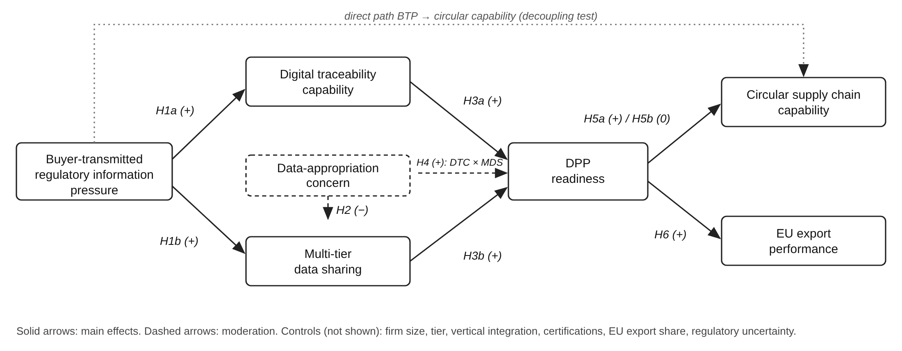

# Abstract

The EU's Digital Product Passport (DPP) for textiles will make product-level sustainability data a condition of market access. Most of those data originate with suppliers several tiers upstream in exporting countries. Drawing on organizational information processing theory, we argue that EU regulation, transmitted through buyers, raises suppliers' information-processing requirements. Suppliers respond by building vertical (digital traceability) and lateral (multi-tier data-sharing) capacity, which jointly produce passport readiness. Data-appropriation concern weakens how far buyer pressure turns into upstream sharing. Drawing on institutional theory, we also test whether readiness enables circular supply chain capability or is decoupled as ceremonial compliance. A two-wave survey of [N] Indian textile and apparel exporters, collected in February–March 2027 and analysed with PLS-SEM, shows [summary of findings]. We offer a readiness diagnostic for suppliers and brands, and we show where public support could close the "passport gap" without excluding small suppliers from EU value chains.

*Keywords:* digital product passport; circular economy; apparel supply chains; organizational information processing theory; multi-tier traceability; India

# Introduction

Every garment sold in the European Union will soon carry a passport. Under the Ecodesign for Sustainable Products Regulation (ESPR), a Digital Product Passport (DPP), reached through a QR code or other data carrier, will record fibre composition, origin by processing stage, substances of concern, environmental footprint, durability, repairability and recyclability (European Parliament and Council, 2024). The textile delegated act is planned for 2027. Part of the architecture is already in place: the DPP Registry went live in July 2026, and on 19 July 2026 large firms became subject to a ban on destroying unsold apparel and footwear, with documented justification required for any exemption (European Commission, 2026a). EU waste law now also mandates extended producer responsibility for clothing (European Parliament and Council, 2025).

The passport is usually discussed as the brand's problem. In practice it is the supplier's. A brand cannot report where its cotton was ginned, which dyehouse used which chemicals, or how much water a fabric consumed unless every upstream tier can produce, standardise and share those data (Jensen et al., 2023; King et al., 2023). Multi-tier visibility is notoriously weak in apparel (Villena & Gioia, 2018; Wilhelm et al., 2016), and the information burden falls most heavily on suppliers in the Global South.

India makes this tension concrete and current. After U.S. tariffs of up to 50% from August 2025, Indian exporters began moving shipments toward the EU. The EU–India free trade agreement concluded in January 2026 promises to remove the roughly 12% EU duty on Indian apparel once ratified (European Commission, 2026b; Reuters, 2026). Apparel exports to the EU reached a record of about US$4.7 billion in 2025–26, still only around 3% of the EU apparel import market. Indian suppliers are therefore turning toward a market that is about to make product-level data a condition of entry. Whether they can supply those data is a supply chain design question that must be answered now, before the mandate, while investment choices remain open.

We ask three questions. (1) How do suppliers build the capacity to produce passport-grade data? (2) What relational conditions block or enable that capacity? (3) Does passport readiness translate into circular supply chain capability and export performance, or into paperwork? To make sense of a fast-moving regulatory landscape (Fawcett & Waller, 2011), we answer them with organizational information processing theory (OIPT; Galbraith, 1974; Tushman & Nadler, 1978), complemented by institutional theory (DiMaggio & Powell, 1983; Meyer & Rowan, 1977), and with survey data from Indian textile and apparel exporters collected in 2027.

We make three contributions. First, we extend OIPT from intra-firm and dyadic settings (Premkumar et al., 2005; Srinivasan & Swink, 2018) to *regulation-induced, multi-tier* information requirements. Second, we identify *data-appropriation concern* as a relational boundary condition that explains why buyer pressure does not automatically produce upstream transparency. Third, we test competing predictions about whether passport data close material loops or are decoupled from practice. That test speaks directly to the connections and trade-offs between sustainability, risk and operational excellence that supply chain designers must manage.

# Theory and Hypotheses

## The Passport as an Information-Processing Problem

OIPT holds that organisations perform better when their *information-processing capacity* matches their *information-processing requirements* (Galbraith, 1974; Tushman & Nadler, 1978). Requirements rise with uncertainty and interdependence. Capacity can be built vertically, through information systems, or laterally, through relations that move information across boundaries (Galbraith, 1974; Premkumar et al., 2005). Supply chain scholars have used OIPT to explain how visibility and analytics improve performance (Srinivasan & Swink, 2018). It has rarely been applied to *regulation-imposed*, product-level data requirements that cross several tiers.

The DPP is such a requirement. It turns diffuse sustainability expectations into structured data fields at the level of the style or batch. For an exporter, the requirement arrives *through the buyer*: EU brands pass down data requests, codes of conduct and, increasingly, contractual data clauses. We call this **buyer-transmitted regulatory information pressure**. In institutional terms the pressure is coercive (DiMaggio & Powell, 1983; Zhu & Sarkis, 2007), but its content is informational: suppliers must collect, validate and pass on data they often do not hold.

Indian apparel supply chains make these requirements unusually demanding. Production is fragmented across small and medium-sized firms. Dyeing, printing, embroidery and even stitching are often subcontracted as job work, and yarn and fabric are bought through traders who may not disclose the mill of origin. A single garment can therefore pass through five or more independent firms before shipment, each holding a fragment of the passport's data. In OIPT terms, interdependence is high and largely invisible to the exporter. The information-processing requirement is not only *more data* but *data from actors the exporter does not control*.

## Building Capacity: Vertical and Lateral

Suppliers can respond in two ways. **Digital traceability capability** (vertical) is the extent to which a firm records material and process data in structured, interoperable digital form, linked to batches and styles rather than kept in spreadsheets and paper certificates (Agrawal et al., 2021; Kouhizadeh et al., 2021). **Multi-tier data sharing** (lateral) is the extent to which upstream mills, dyehouses, spinners and fibre suppliers provide timely, accurate data to the focal firm (Fawcett et al., 2007; Kembro et al., 2017). OIPT predicts that rising requirements trigger investment in both.

> **H1.** Buyer-transmitted regulatory information pressure is positively associated with (a) digital traceability capability and (b) multi-tier data sharing.

Lateral capacity depends on willingness as well as connectivity (Fawcett et al., 2007). Passport data are commercially sensitive. Cost structures, sub-supplier identities and process yields can be used by buyers to renegotiate prices or bypass the supplier, and by rivals to poach customers. Where this **data-appropriation concern** is high, suppliers and their sub-suppliers will hold back data or share it only selectively, so pressure turns into ceremonial requests rather than real upstream sharing (King et al., 2023; Sodhi & Tang, 2019).

> **H2.** Data-appropriation concern weakens the positive relationship between buyer-transmitted pressure and multi-tier data sharing.

## From Capacity to Passport Readiness

We define **DPP readiness** as a firm's ability to supply, at style or batch level, the data categories expected in a textile passport (European Parliamentary Research Service, 2024; Jensen et al., 2023). Digital systems make data storable and transferable. Upstream sharing supplies the content. Each therefore contributes to readiness.

> **H3.** (a) Digital traceability capability and (b) multi-tier data sharing are positively associated with DPP readiness.

OIPT also suggests that the two forms of capacity complement each other: systems without upstream data are empty containers, and shared data without systems remain unusable in the formats passports require (Srinivasan & Swink, 2018).

> **H4.** Digital traceability capability and multi-tier data sharing interact positively in predicting DPP readiness.

## Does Readiness Close Loops? Competing Expectations

The passport's policy logic is that information enables circularity: knowing fibre blends and chemistry makes sorting, recycling and reuse economically feasible (Adisorn et al., 2021; Jensen et al., 2023). On this view, readiness should enable **circular supply chain capability**: reuse of pre-consumer waste and unsold stock, use of recycled inputs, and design-for-recycling with buyers (Jia et al., 2020).

> **H5a.** DPP readiness is positively associated with circular supply chain capability.

Institutional theory warns, however, that organisations facing coercive demands often *decouple*: they adopt the visible structure while leaving core practice unchanged (Meyer & Rowan, 1977). When the data are collected for the buyer's file and not for the supplier's own decisions, readiness may coexist with linear practice.

> **H5b (competing).** DPP readiness is unrelated to circular supply chain capability once buyer-transmitted pressure is controlled for (decoupling).

Finally, if passport data become an order qualifier, readiness should support suppliers' standing with EU buyers.

> **H6.** DPP readiness is positively associated with EU export performance.

Figure 1 summarises the model.

{width=100%}

# Method

## Setting, Sample and Procedure

India's textile and apparel exports were about US$37.5 billion in 2025, and the EU is their second-largest destination (Reuters, 2026). The population is Indian textile and apparel manufacturer-exporters with at least one EU buyer. The sampling frame combines the Apparel Export Promotion Council member directory with cluster association lists for Tiruppur, Bengaluru, the National Capital Region, Ludhiana and Kolkata, covering knitwear, woven garments, home textiles and fabric processing. Key informants are owners, directors, or heads of compliance, sustainability or merchandising with at least one year's tenure who pass two competence screens (Online Appendix A).

The survey was administered online and by telephone in English, Hindi and Tamil, with translation and back-translation. To reduce common-method variance (Podsakoff et al., 2003), we separated measurement in time. Wave 1 (February 2027) captured pressure, appropriation concern, the two capacities and controls. Wave 2 (March 2027) captured DPP readiness, circular capability and performance. Of [X] firms contacted, [Y] completed wave 1 and [N] completed both waves (response rate [Z]%). Early and late respondents did [not] differ on any study variable (Armstrong & Overton, 1977), and respondents did [not] differ from non-respondents on directory size or region. Power analysis (f² = 0.15, α = 0.05, 1−β = 0.80, 10 predictors) required a minimum of 118 firms.

## Measures

All constructs use multi-item reflective scales on 7-point Likert scales (Online Appendix A). Buyer-transmitted pressure adapts institutional pressure items (Zhu & Sarkis, 2007) to EU data demands. Multi-tier data sharing adapts information sharing (Fawcett et al., 2007) and multi-tier visibility measures (Kembro et al., 2017). Digital traceability capability adapts supply visibility items (Srinivasan & Swink, 2018). Data-appropriation concern and DPP readiness are new scales. Their items were generated from the ESPR text, the European Parliamentary Research Service (2024) textile DPP study and Jensen et al.'s (2023) data clusters, refined in expert interviews, and checked with a card-sorting task. Circular supply chain capability adapts circular economy practice items from the textile literature (Jia et al., 2020). EU export performance combines perceived performance relative to competitors with a reported change in EU export share. Controls are firm size (log employees), tier (finished goods versus intermediate), vertical integration, number of sustainability certifications, EU share of exports and perceived regulatory uncertainty.

## Analysis

We use PLS-SEM because the model is prediction-oriented, includes interaction terms and new scales, and the sample is moderate (Hair et al., 2019). Measurement is evaluated with loadings, composite reliability, AVE and HTMT (Henseler et al., 2015). Common-method variance is additionally checked with full-collinearity VIFs (Kock, 2015) and a marker variable. Interactions (H2, H4) use the two-stage approach. Significance uses 10,000 bootstrap samples. H5a versus H5b is decided by the sign, size and confidence interval of the DPP readiness → circular capability path, with buyer pressure included as a direct predictor of circular capability and an equivalence test to distinguish a true null from a non-significant effect. Out-of-sample predictive power is assessed with PLSpredict (Shmueli et al., 2019). Online Appendix B reports the full analysis plan and robustness checks.

# Results

## Measurement Model

All indicator loadings exceeded [0.708], composite reliabilities ranged from [ ] to [ ], and every AVE exceeded [0.50] (Table 1). HTMT ratios were all below [0.85], with bootstrap confidence intervals excluding 1, supporting discriminant validity. Full-collinearity VIFs ranged from [ ] to [ ], below the 3.3 threshold, and controlling for the marker variable changed no path by more than [ ]. Common-method variance is therefore unlikely to account for the results.

**Table 1.** Measurement model: loadings, reliability, AVE and HTMT. *[Populated from the 2027 data.]*

## Structural Model

Table 2 reports the hypothesis tests. The model explains [ ]% of the variance in DPP readiness, [ ]% in circular supply chain capability and [ ]% in EU export performance. Buyer-transmitted pressure was [positively] associated with digital traceability capability (H1a) and multi-tier data sharing (H1b). The effect on sharing was [weaker] when data-appropriation concern was high (H2): at one standard deviation above the mean, the simple slope was [ ], compared with [ ] at one standard deviation below. Both capacities predicted readiness (H3a, H3b), with [multi-tier sharing / digital traceability] having the larger effect size. Their interaction was [positive] (H4), so traceability systems added [little / substantially] to readiness when upstream sharing was low.

For the competing hypotheses, the readiness → circular capability path was [ ] (95% CI [ , ]). The data therefore favour [H5a / H5b]. Readiness was [positively] associated with EU export performance (H6), and the result held when we used the objective change in EU export share. PLSpredict showed [lower] prediction errors than the linear benchmark for [ ] of [ ] readiness indicators, indicating [medium] predictive power. Results were robust to excluding yarn and fibre suppliers, to multi-group comparisons by firm size and cluster, and to a Gaussian copula test for endogeneity (Online Appendix B).

**Table 2.** Structural model results (95% bootstrap confidence intervals, 10,000 resamples).

| Hypothesis | Path | β | 95% CI | f² | Supported? |
|---|---|---|---|---|---|
| H1a | Pressure → Digital traceability | [ ] | [ ] | [ ] | [ ] |
| H1b | Pressure → Multi-tier sharing | [ ] | [ ] | [ ] | [ ] |
| H2 | Pressure × Appropriation concern → Sharing | [ ] | [ ] | [ ] | [ ] |
| H3a | Digital traceability → DPP readiness | [ ] | [ ] | [ ] | [ ] |
| H3b | Multi-tier sharing → DPP readiness | [ ] | [ ] | [ ] | [ ] |
| H4 | Traceability × Sharing → DPP readiness | [ ] | [ ] | [ ] | [ ] |
| H5a/H5b | DPP readiness → Circular capability | [ ] | [ ] | [ ] | [ ] |
| H6 | DPP readiness → EU export performance | [ ] | [ ] | [ ] | [ ] |

# Discussion

## Theoretical Implications

First, the study moves OIPT from fit *inside* a firm or dyad to fit *imposed from outside* by regulation and transmitted through buyers. In this setting the firm does not choose its requirements; it chooses only whether to build capacity, and through which channel. Second, data-appropriation concern adds a relational condition that OIPT has largely left implicit: lateral capacity requires a willingness to give data away, and that willingness depends on how the receiver might use the data (Fawcett et al., 2007; Gualandris et al., 2021). Third, the H5a/H5b test speaks to the supply chain transparency literature (Montecchi et al., 2021; Sodhi & Tang, 2019). If readiness is decoupled from circular capability, the passport risks becoming traceability without circularity: compliance data that sit in a registry while material still flows to landfill. Fourth, the findings clarify a trade-off central to supply chain design. Building passport capacity consumes scarce managerial attention and capital that small exporters would otherwise spend on cost, speed and quality, which are the operational foundations of their competitiveness. If readiness pays off through EU export performance, sustainability and operational excellence reinforce each other. If it does not, the passport imposes a compliance cost that the weakest suppliers can least afford.

## Managerial Implications

**Key insights for practitioners.**

* **The passport is a supply chain design decision, not a software purchase.** Readiness depends on [upstream data sharing at least as much as on systems]. Map which tier holds each passport data field before buying a platform.
* **Fix trust before technology.** Where suppliers fear their data will be used against them, buyer pressure produces [less] sharing. Brands that limit how they use supplier data, share verification costs or pay for verified data will get better passports.
* **Use the data, not just file it.** Readiness pays off in circular capability [only when] firms use passport data for their own decisions on waste, recycled inputs and unsold stock.
* **Start now.** The data fields will be fixed in 2027, but the capacity to fill them takes years to build across tiers.

For **suppliers**, the analysis shows whether investing in systems, in upstream relationships, or in both yields readiness. For **brands**, the appropriation-concern results matter for how data requests are designed. For both, the readiness scale (Online Appendix A) can serve as a self-diagnostic before the delegated act fixes the data fields.

## Policy Implications

The passport shifts information-processing costs upstream, to the actors least able to bear them. If readiness depends on multi-tier sharing that small sub-suppliers cannot provide, the passport could unintentionally concentrate EU sourcing among large, vertically integrated exporters. Two levers follow. First, shared data infrastructure, such as cluster-level traceability platforms in Tiruppur or Ludhiana run by industry associations, lowers the fixed cost of vertical capacity. Second, enforceable data-use safeguards, built into the passport's access rights or into the EU–India agreement's sustainability chapter, lower appropriation concern.

## Limitations and Future Research

The design is cross-sectional across two waves and relies on single key informants, so causal claims are limited. Readiness is self-assessed before the delegated act fixes the data fields. Once the passport is mandatory, follow-up studies should link readiness to audited passport data, test generalisation to Bangladesh, Vietnam and Türkiye, and use buyer–supplier dyads to capture both sides of appropriation concern.

# Conclusion

The Digital Product Passport is a supply chain design decision disguised as a compliance requirement. Whether it becomes a tool for circularity or a new barrier to trade will be decided in the next eighteen months, in supplier factories far from Brussels. Our study shows [one-sentence headline finding] and points to where firms and governments should invest first.

# References

Adisorn, T., Tholen, L., & Götz, T. (2021). Towards a digital product passport fit for contributing to a circular economy. *Energies, 14*(8), 2289. https://doi.org/10.3390/en14082289

Agrawal, T. K., Kumar, V., Pal, R., Wang, L., & Chen, Y. (2021). Blockchain-based framework for supply chain traceability: A case example of textile and clothing industry. *Computers & Industrial Engineering, 154*, 107130. https://doi.org/10.1016/j.cie.2021.107130

Armstrong, J. S., & Overton, T. S. (1977). Estimating nonresponse bias in mail surveys. *Journal of Marketing Research, 14*(3), 396–402.

DiMaggio, P. J., & Powell, W. W. (1983). The iron cage revisited: Institutional isomorphism and collective rationality in organizational fields. *American Sociological Review, 48*(2), 147–160.

European Commission. (2026a). *Commission Delegated Regulation (EU) 2026/296 on derogations from the prohibition of the destruction of unsold consumer products*. Official Journal of the European Union.

European Commission. (2026b, January 27). *EU and India conclude negotiations for a free trade agreement* [Press release].

European Parliament and Council. (2024). Regulation (EU) 2024/1781 establishing a framework for the setting of ecodesign requirements for sustainable products. *Official Journal of the European Union*, L 2024/1781.

European Parliament and Council. (2025). Directive (EU) 2025/1892 amending Directive 2008/98/EC on waste. *Official Journal of the European Union*.

European Parliamentary Research Service. (2024). *Digital product passport for the textile sector* (PE 757.808). Panel for the Future of Science and Technology.

Fawcett, S. E., Osterhaus, P., Magnan, G. M., Brau, J. C., & McCarter, M. W. (2007). Information sharing and supply chain performance: The role of connectivity and willingness. *Supply Chain Management: An International Journal, 12*(5), 358–368.

Fawcett, S. E., & Waller, M. A. (2011). Making sense out of chaos? Why theory is relevant to supply chain research. *Journal of Business Logistics, 32*(1), 1–5.

Galbraith, J. R. (1974). Organization design: An information processing view. *Interfaces, 4*(3), 28–36.

Gualandris, J., Longoni, A., Luzzini, D., & Pagell, M. (2021). The association between supply chain structure and transparency: A large-scale empirical study. *Journal of Operations Management, 67*(7), 803–827.

Hair, J. F., Risher, J. J., Sarstedt, M., & Ringle, C. M. (2019). When to use and how to report the results of PLS-SEM. *European Business Review, 31*(1), 2–24.

Henseler, J., Ringle, C. M., & Sarstedt, M. (2015). A new criterion for assessing discriminant validity in variance-based structural equation modeling. *Journal of the Academy of Marketing Science, 43*(1), 115–135.

Jensen, S. F., Kristensen, J. H., Adamsen, S., Christensen, A., & Waehrens, B. V. (2023). Digital product passports for a circular economy: Data needs for product life cycle decision-making. *Sustainable Production and Consumption, 37*, 242–255. https://doi.org/10.1016/j.spc.2023.02.021

Jia, F., Yin, S., Chen, L., & Chen, X. (2020). The circular economy in the textile and apparel industry: A systematic literature review. *Journal of Cleaner Production, 259*, 120728.

Kembro, J., Näslund, D., & Olhager, J. (2017). Information sharing across multiple supply chain tiers: A Delphi study on antecedents. *International Journal of Production Economics, 193*, 77–86.

King, M. R. N., Timms, P. D., & Mountney, S. (2023). A proposed universal definition of a Digital Product Passport Ecosystem (DPPE): Worldviews, discrete capabilities, stakeholder requirements and concerns. *Journal of Cleaner Production, 384*, 135538. https://doi.org/10.1016/j.jclepro.2022.135538

Kock, N. (2015). Common method bias in PLS-SEM: A full collinearity assessment approach. *International Journal of e-Collaboration, 11*(4), 1–10.

Kouhizadeh, M., Saberi, S., & Sarkis, J. (2021). Blockchain technology and the sustainable supply chain: Theoretically exploring adoption barriers. *International Journal of Production Economics, 231*, 107831.

Meyer, J. W., & Rowan, B. (1977). Institutionalized organizations: Formal structure as myth and ceremony. *American Journal of Sociology, 83*(2), 340–363.

Montecchi, M., Plangger, K., & West, D. C. (2021). Supply chain transparency: A bibliometric review and research agenda. *International Journal of Production Economics, 238*, 108152.

Podsakoff, P. M., MacKenzie, S. B., Lee, J.-Y., & Podsakoff, N. P. (2003). Common method biases in behavioral research: A critical review of the literature and recommended remedies. *Journal of Applied Psychology, 88*(5), 879–903.

Premkumar, G., Ramamurthy, K., & Saunders, C. S. (2005). Information processing view of organizations: An exploratory examination of fit in the context of interorganizational relationships. *Journal of Management Information Systems, 22*(1), 257–294.

Reuters. (2026, January). India's textile exporters pin hopes on EU deal after US tariff blow. *Reuters*.

Shmueli, G., Sarstedt, M., Hair, J. F., Cheah, J.-H., Ting, H., Vaithilingam, S., & Ringle, C. M. (2019). Predictive model assessment in PLS-SEM: Guidelines for using PLSpredict. *European Journal of Marketing, 53*(11), 2322–2347.

Sodhi, M. S., & Tang, C. S. (2019). Research opportunities in supply chain transparency. *Production and Operations Management, 28*(12), 2946–2959.

Srinivasan, R., & Swink, M. (2018). An investigation of visibility and flexibility as complements to supply chain analytics: An organizational information processing theory perspective. *Production and Operations Management, 27*(10), 1849–1867. https://doi.org/10.1111/poms.12746

Tushman, M. L., & Nadler, D. A. (1978). Information processing as an integrating concept in organizational design. *Academy of Management Review, 3*(3), 613–624.

Villena, V. H., & Gioia, D. A. (2018). On the riskiness of lower-tier suppliers: Managing sustainability in supply networks. *Journal of Operations Management, 64*, 65–87.

Wilhelm, M. M., Blome, C., Bhakoo, V., & Paulraj, A. (2016). Sustainability in multi-tier supply chains: Understanding the double agency role of the first-tier supplier. *Journal of Operations Management, 41*, 42–60.

Zhu, Q., & Sarkis, J. (2007). The moderating effects of institutional pressures on emergent green supply chain practices and performance. *International Journal of Production Research, 45*(18–19), 4333–4355.
